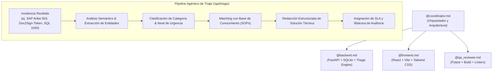

# 🚀 TicketTriage AI - Sistema Agéntico de Triaje, Resolución y Documentación de Tickets

Plataforma inteligente multiagente para la clasificación automática, priorización de severidad (SLA), diagnóstico técnico y generación asistida de resoluciones paso a paso para incidencias de soporte corporativo.

Construido bajo el patrón de arquitectura **Coordinator-Workers** con agentes especializados documentados en `.antigravity/` y orquestados mediante `TASKS.md`.

---

## 🏛️ Arquitectura del Sistema Multiagente

El ciclo de desarrollo y ejecución técnica del proyecto está gobernado por cuatro agentes autónomos:



### Roles de los Agentes (`.antigravity/`)
1. **`@coordinator.md` (Agente Orquestador)**: Establece los contratos de datos canónicos (OpenAPI / Pydantic / TypeScript), gestiona la interfaz entre backend y frontend, y gobierna el checklist en `TASKS.md`.
2. **`@backend.md` (Agente Backend & IA)**: Implementa la API REST con FastAPI, persistencia relacional SQLite con SQLAlchemy y el motor agéntico de triaje y matching con la base de conocimiento corporativa.
3. **`@frontend.md` (Agente UI/UX)**: Implementa la consola operacional SPA moderna tipo SaaS Enterprise (React 19, Vite, Tailwind CSS, Lucide Icons) con vistas de tabla, Kanban, analítica y simulador en tiempo real.
4. **`@qa_reviewer.md` (Agente de Calidad)**: Ejecuta suites de pruebas unitarias/integración (`pytest`) y asegura compilación libre de errores ni advertencias.

---

## ⚡ Stack Tecnológico

| Capa | Tecnologías |
|---|---|
| **Backend** | Python 3.10+, FastAPI, Uvicorn, SQLAlchemy 2.0, Pydantic v2, SQLite |
| **IA & Triaje** | Motor agéntico heurístico + RAG léxico-semántico sobre SOPs corporativos |
| **Frontend** | React 19, Vite 8, Tailwind CSS v4, Lucide Icons, Fetch API |
| **Testing** | Pytest, FastAPI TestClient, Httpx |
| **Orquestación** | Scripts concurrentes y multiplataforma (`.bat` / `.sh`) |

---

## 📊 Vistas y Capacidades del Frontend

- **Bandeja de Operaciones & Kanban**:
  - Filtros instantáneos por Urgencia (`Crítica`, `Alta`, `Media`, `Baja`) y Estado (`Abierto`, `En Proceso`, `Resuelto`).
  - Switcher entre **Tabla Densa** con badges de estado y **Tablero Kanban** con transiciones de 1-click.
- **Detalle de Ticket & Análisis de IA**:
  - Visualización del diagnóstico generado por el agente de triaje, nivel de confianza (%) y procedimiento estándar (SOP) asociado.
  - Editor interactivo para modificar la solución propuesta antes de notificar al usuario.
  - Botón de cierre y resolución en un solo clic.
  - Línea de tiempo completa de auditoría y trazabilidad cronológica.
- **Simulador de Incidencias en Tiempo Real**:
  - Modal interactivo con plantillas precargadas de 1-click (SAP Ariba 503, Doc2Sign error de firma, Deadlock en SQL Server, Okta MFA bloqueado).
  - Previsualización en vivo del análisis de IA (`dry_run`) y creación instantánea en base de datos.
- **Analítica Operacional & SLA**:
  - Gráficos de distribución de incidentes por dominio corporativo y severidad.
  - Estimación de horas de ingeniería ahorradas y tasa de automatización.
- **Base de Conocimiento Corporativo (SOPs)**:
  - Catálogo de procedimientos operativos estándar indexados y consultables por los analistas.

---

## 🚀 Puesta en Marcha Rápida

### Opción 1: Lanzador Todo-en-Uno (Windows)
Ejecuta el script dual que abrirá tanto el Backend como el Frontend en ventanas independientes:
```cmd
run_all.bat
```

### Opción 2: Ejecución Manual por Componente

#### Backend (FastAPI):
```cmd
# En Windows:
run_backend.bat

# En Linux/macOS:
chmod +x run_backend.sh
./run_backend.sh
```
*El backend se ejecutará en:* `http://127.0.0.1:8000`  
*Documentación interactiva Swagger UI:* `http://127.0.0.1:8000/docs`

#### Frontend (React + Vite):
```cmd
# En Windows:
run_frontend.bat

# En Linux/macOS:
chmod +x run_frontend.sh
./run_frontend.sh
```
*El frontend se ejecutará en:* `http://localhost:5173`

---

## 🔌 Catálogo de Endpoints REST

| Método | Endpoint | Descripción |
|---|---|---|
| `GET` | `/api/health` | Estado de salud del servidor y motor agéntico |
| `GET` | `/api/tickets` | Listado de tickets con filtros (`urgency`, `status`, `category`, `search`) |
| `GET` | `/api/tickets/{id}` | Detalle completo de un ticket con su historial de auditoría |
| `POST` | `/api/tickets` | Creación manual de un ticket |
| `PATCH` | `/api/tickets/{id}` | Actualización de estado, solución sugerida o asignación |
| `POST` | `/api/triage` | **Pipeline Agéntico**: Clasificación, severidad, matching KB y solución sugerida |
| `GET` | `/api/analytics` | KPIs de soporte, tiempo ahorrado y distribución por categoría/urgencia |
| `GET` | `/api/knowledge` | Catálogo de artículos y SOPs corporativos |

---

## 🧪 Pruebas Automatizadas

Para ejecutar la suite de pruebas del backend:
```bash
# Desde la raíz del proyecto:
.\backend\venv\Scripts\pytest -v

# O en Linux/macOS:
./backend/venv/bin/pytest -v
```

Resultado de las pruebas:
```
backend/tests/test_api.py::test_health_check PASSED                      [ 11%]
backend/tests/test_api.py::test_get_tickets PASSED                       [ 22%]
backend/tests/test_api.py::test_filter_tickets_by_urgency PASSED         [ 33%]
backend/tests/test_api.py::test_get_ticket_detail PASSED                 [ 44%]
backend/tests/test_api.py::test_patch_ticket PASSED                      [ 55%]
backend/tests/test_api.py::test_triage_dry_run PASSED                    [ 66%]
backend/tests/test_api.py::test_triage_persist_ticket PASSED             [ 77%]
backend/tests/test_api.py::test_get_analytics PASSED                     [ 88%]
backend/tests/test_api.py::test_get_knowledge PASSED                     [100%]
```

---

## 📦 Semillero de Datos Incluido

El script `backend/seed_data.py` precarga 12 incidencias corporativas realistas:
1. **SAP Ariba**: Error 503 Bad Gateway en aprobación de órdenes de compra (Crítica).
2. **Doc2Sign**: Error de certificado y token expirado en contrato NDA (Alta).
3. **SQL Server Cluster**: Deadlocks y Access Denied 18456 en cierre contable (Crítica).
4. **Okta IAM**: MFA bloqueado tras cambio de smartphone para VP (Alta).
5. **Cisco AnyConnect**: Desconexiones continuas de VPN para usuarios remotos (Media).
6. **Microsoft 365 Exchange**: Buzón de facturación exhausto 554 5.2.2 (Alta).
7. **CrowdStrike Falcon EDR**: Binario de compilación en cuarentena preventiva (Alta).
8. **Jira Atlassian**: Error 'No permission to transition' en historias de usuario (Baja).
9. **Doc2Sign Connect**: Timeout en webhook hacia Salesforce CRM (Alta).
10. **PostgreSQL Clientes**: Agotamiento de pool de conexiones (Crítica).
11. **Adobe Acrobat**: Solicitud de configuración de servidor timestamp RFC 3161 (Baja).
12. **SAP S/4HANA**: Error en aprovisionamiento IDOC HRMD_A (Media).

---

## 📄 Licencia
Este proyecto es software libre bajo la licencia MIT.
